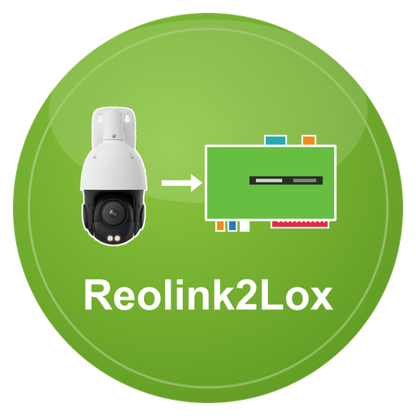

# Reolink2Lox – LoxBerry-Plugin

**Version 0.1.1** · Benötigt LoxBerry 4 (PHP ≥ 8.4) · [Changelog](CHANGELOG.md)

Dokumentation: [docs/wiki/Home.md](docs/wiki/Home.md)

Fragt **Reolink-Kameras** über deren lokale HTTP-API ab (HTTPS oder HTTP, ohne Cloud) und veröffentlicht Bewegung, KI-Erkennung (Person, Fahrzeug, Tier), Licht, Zoom, Aufnahme und mehr per MQTT am LoxBerry-Broker (→ MQTT-Gateway → Loxone). Dazu Befehle aus Loxone (Scheinwerfer, Infrarot, Status-LED, Schwenken, Zoom, Fokus, Positionen, Sirene, Aufnahme, Push, E-Mail, FTP), ab Werk gesperrt und mit Quittung. Bis zu **fünf Kameras**. Ersetzt den ioBroker-Adapter `reolink`. Reolink-Kameras haben keinen MQTT-Anschluss; das Plugin ist die Brücke.

**Beta (0.1.1): geprüft ist bisher eine RLC-823S1** (Schwenk-Neige-Kamera mit Scheinwerfer, Firmware v3.1.0.4885): Auslesen, Licht, Zoom, Fokus, Schwenken, gespeicherte Positionen, Aufnahme, Push, E-Mail, FTP und die Sirene (einmal abspielen und stoppen). Andere Modelle sind nach der API-Beschreibung der Bibliothek `reolink_aio` umgesetzt und erkennen über die Fähigkeiten der Kamera, was sie können (Spezifikation: [SPEZIFIKATION.md](SPEZIFIKATION.md)).

## Voraussetzungen an der Kamera
- In der Kamera muss der Zugriff über **HTTPS oder HTTP** aktiv sein (Reolink-App oder Weboberfläche → Einstellungen → Netzwerk → Erweitert → Server-Einstellungen). Das Plugin probiert erst HTTPS, dann HTTP.
- Am besten einen **eigenen Benutzer** für das Plugin anlegen. **Lesen** geht mit einem normalen Benutzer, **Schalten** braucht einen **Administrator**.
- Die Kamera erlaubt nur wenige gleichzeitige Anmeldungen. Das Plugin meldet sich einmal an, nutzt die Sitzung weiter und meldet sich beim Beenden ab.

## Installation
1. `bash build.sh` → `reolink2lox-<version>.zip` (oder ZIP von den Releases)
2. In LoxBerry → Plugin-Verwaltung → ZIP installieren.
3. Plugin öffnen, Reiter „Kameras“: Host/IP, Benutzer und Passwort eintragen, **Aktiv** anhaken, speichern.
4. Im MQTT Gateway das Abo `reolink/#` eintragen (Gateway V1 über die Abo-Datei des Plugins, **Gateway V2 von Hand**; der Reiter „MQTT“ zeigt es).
5. Reiter „Test“ → „Sofort abrufen“ und „Selbstprüfung“. Werte erscheinen unter `reolink/<name>/*`.

**Immer das neueste Release:** `https://github.com/ricten/Reolink2Lox/releases/latest/download/reolink2lox.zip` (ZIP ohne Version im Namen). **Automatische Updates:** Neue Installationen stehen in der Plugin-Verwaltung auf „Releases“, LoxBerry prüft täglich die `release.cfg` im Repository und installiert neuere Versionen selbst (Details: [docs/wiki/Installation.md](docs/wiki/Installation.md)).

## Topics (Auszug)
`reolink/hof/bewegung`, `person`, `fahrzeug`, `tier`, `alarm`, `alarm_ts`, `licht/scheinwerfer`, `licht/ir`, `ptz/zoom`, `aufnahme`, `meldung/push`, `sd/belegt_prozent`, `verbunden`, `reolink/status/ok|zaehler|ts`.
Befehle: `reolink/befehl/<name>/scheinwerfer|scheinwerfer_modus|scheinwerfer_helligkeit|ir|status_led|ptz|ptz_position|zoom|fokus|autofokus|sirene|aufnahme|push|email|ftp`, Quittung unter `…/quittung`.
Vollständige Liste: [docs/wiki/MQTT-Topics.md](docs/wiki/MQTT-Topics.md).

## MQTT-Broker
Standard ist der Broker des LoxBerry (Zugangsdaten verwaltet LoxBerry). Alternativ lässt sich im Reiter „MQTT“ ein eigener Broker eintragen. Die Kameras sind davon unabhängig.

## Entwicklung
- Tests: `php tests/run.php` (unter Windows ohne `php.ini`: `php -d extension_dir=<php>/ext -d extension=openssl tests/run.php`, die Fake-Kamera braucht TLS)
- Details und Regeln: [CLAUDE.md](CLAUDE.md), [docs/wiki/Entwicklung.md](docs/wiki/Entwicklung.md)

## Lizenz
MIT, siehe [LICENSE](LICENSE). Reolink ist eine Marke der Reolink Innovation Limited; dieses Plugin ist inoffiziell.
