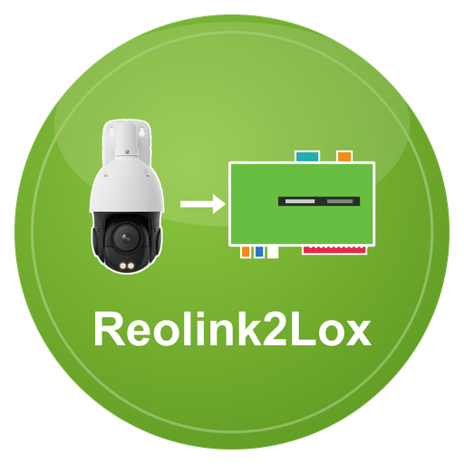

# Reolink2Lox

**Reolink2Lox** ist ein LoxBerry-Plugin, das **Reolink-Kameras** über deren lokale HTTP-API abfragt und die Werte an den MQTT-Broker des LoxBerry veröffentlicht. Über das LoxBerry-MQTT-Gateway gelangen sie an den Loxone Miniserver. Es nimmt außerdem Befehle aus Loxone an (Scheinwerfer, Infrarot, Schwenken, Zoom, Aufnahme …). Es ersetzt den ioBroker-Adapter `reolink`. Reolink-Kameras haben keinen MQTT-Anschluss; das Plugin ist die Brücke.

> **Stand: Beta (0.1.2).** Geprüft ist bisher eine **RLC-823S1** (Schwenk-Neige-Kamera mit Scheinwerfer, Firmware v3.1.0.4885): Auslesen, Licht, Zoom, Fokus, Schwenken, gespeicherte Positionen, Aufnahme, Push, E-Mail, FTP und die Sirene (einmal abspielen und stoppen). Andere Modelle sind nach der API-Beschreibung der Bibliothek `reolink_aio` umgesetzt; das Plugin liest die Fähigkeiten der Kamera und bietet nur an, was sie kann. Rückmeldungen sind willkommen.

## Was kann das Plugin?

- Fragt bis zu **5 Kameras** ab, jede unter eigenem Namen (`reolink/<name>/…`); die Verbindung geht direkt zur Kamera (HTTPS mit selbst signiertem Zertifikat oder HTTP), **nichts über die Reolink-Cloud**
- **Erkennung:** Bewegung und KI-Erkennung (Person, Fahrzeug, Tier; je nach Modell Gesicht, Paket, Besucher) im Sekundentakt, dazu `alarm` und der Zeitstempel `alarm_ts`
- **Licht:** Scheinwerfer (Zustand, Betriebsart, Helligkeit), Infrarot-Licht, Status-LED
- **Objektiv:** Zoom, Fokus, Autofokus
- **Aufnahme und Meldungen:** Aufnahme (Zeitplan), Push, E-Mail, FTP der Kamera ein/aus
- **Kamera:** Last, Speicherkarte (Größe, frei, Belegung), Modell, Firmware
- **Befehle aus Loxone** (ab Werk gesperrt, je Kamera in vier Stufen freizugeben, mit Quittung): Scheinwerfer, Infrarot, Status-LED, Schwenken, gespeicherte Positionen, Zoom, Fokus, Autofokus, Sirene, Aufnahme, Push, E-Mail, FTP
- Veröffentlicht nur **Änderungen** (alle 5 Minuten alle Werte)
- MQTT-Broker des LoxBerry oder **eigener Broker**
- Lebenszeichen `reolink/status/ok|zaehler|ts` für die Ausfallerkennung in Loxone, Healthcheck
- Weboberfläche mit Kameraliste, MQTT-Reiter (Gateway-Abo), Topic- und Befehlstabelle, Selbstprüfung und Log

## Seiten

1. [Installation](Installation.md)
2. [Konfiguration](Konfiguration.md)
3. [MQTT-Topics](MQTT-Topics.md)
4. [Loxone-Anbindung](Loxone-Anbindung.md)
5. [Fehlersuche](Fehlersuche.md)
6. [Entwicklung](Entwicklung.md)

## Voraussetzungen

- LoxBerry ≥ 4.0 mit aktivem MQTT-Broker (Mosquitto) und MQTT-Gateway (oder eigener Broker)
- PHP ≥ 7.4 (Kommandozeile und Web). Das bringt LoxBerry 4.0 auf Debian 11, 12 und 13 mit (PHP 7.4 bis 8.4). Die Installation prüft das und bricht sonst mit einem Hinweis ab
- Eine Reolink-Kamera im selben Netz mit aktivem HTTPS- oder HTTP-Zugriff und einem Benutzer für das Plugin (Schalten braucht einen Administrator; siehe [Installation](Installation.md))

## Lizenz

MIT, siehe [LICENSE](../../LICENSE). Reolink ist eine Marke der Reolink Innovation Limited; dieses Plugin ist inoffiziell und nicht von Reolink.
